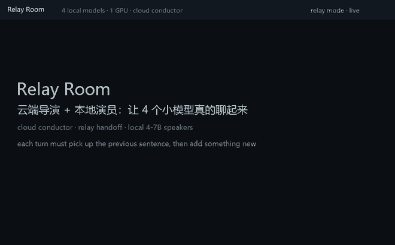

# Relay Room (English)

[中文 README](README.md) · [GitHub](https://github.com/yangbaiwan392-collab/relay-room)

**A cloud-directed relay chat room for local small LLMs.**
Four local 4–7B models share one consumer GPU. A cloud model (the *conductor*) supplies a
fresh angle, one concrete fact, per-speaker assignments and a dynamic ban list every N
rounds. Speakers take turns and **each turn must first pick up the previous speaker's
sentence**, then add something new.



## Why this exists

Put four small models in one room and let each one answer the topic independently (panel /
round-robin, e.g. AutoGen `RoundRobinGroupChat` or SillyTavern group chats). You get four
monologues: **only 2% of turns referenced the previous speaker**, and topics collapsed into
groceries within ~15 rounds.

Two changes fixed it:

1. **Relay**: the supervisor hands speaker B the last ~100 characters of A's sentence and
   requires a short quote/response before adding a point (`relay_guard` rewrites otherwise).
2. **Cloud conductor**: a cloud model reads the transcript tail every N rounds and returns a
   fresh angle, a concrete fact, per-speaker assignments and a dynamic ban list. Local 4B
   models cannot invent new substance on demand; the conductor can.

Measured on the same topic and models: **continuity 2% → 38%**, verbatim duplicates
0.5% → 0.1%, and a 200-round run across four domains without collapse.

## How it works

```
cloud conductor (every N rounds)  ->  angle, fact, assignments, terms, banned
        |
supervisor.py  (turn order, relay guard, dedup/phrase/name/domain guards, SQLite bus)
        |
4 x speaker.py  ->  Ollama (local 4-7B)      chat-view.py / dashboard.py / tools/
```

- SQLite WAL bus per run; one process per speaker; `think: false` for reasoning models.
- Revisions are replace-style: older versions are marked `superseded`, views show one reply.
- The conductor is optional; without it the room keeps relaying but slowly becomes a polite
  echo chamber.

## Quick start

```bash
ollama pull qwen2.5:7b-instruct
ollama pull qwen2.5:3b-instruct
ollama pull qwen2.5:1.5b-instruct
ollama pull qwen3:4b

export CONDUCTOR_API_KEY=sk-...          # any OpenAI-compatible endpoint
python supervisor.py --config configs/starter.json
python chat-view.py                      # live view
```

Windows: `run.cmd` / `show-chat.cmd`. Tested configuration (four abliterated models) and
model-build instructions: [docs/DEPLOY.md](docs/DEPLOY.md).

## Measured results

| Setup | continuity | response | dup | rewrite |
|---|---|---|---|---|
| parallel round-robin (panel) | 2% | — | 0.5% | 0% |
| relay, full previous sentence | 24% | — | 0.0% | high |
| relay + 100-char handoff + 90-char cap | 22% | 58% | 0.5% | medium |
| relay, strict quote check | 34% | 71% | 0.0% | 78% |
| **relay + conductor + guards, 200 rounds** | **38%** | 66% | **0.1%** | 81% |
| one 7B speaker instead of 2B (A/B) | 41% | 72% | 0.5% | 78% |
| structured summaries (A/B) | 8% | 38% | 0.5% | 70% |

Per-domain continuity over 200 rounds: 33% / 43% / 38% / 38% — no decay with length.
Method and caveats: [docs/RESULTS.md](docs/RESULTS.md).

## Cloud cost is negligible

Only the conductor calls the cloud; the speakers are local.

| Scale | cloud calls | cloud tokens | est. cost |
|---|---|---|---|
| 50 rounds | 6 | ~10k | < $0.01 |
| 200 rounds | 24 | ~30k | ~$0.02 |
| 1000 rounds | ~125 | ~150k | ~$0.07 |
| 2000 rounds | ~250 | ~300k | ~$0.15 |

(DeepSeek-class pricing; any OpenAI-compatible endpoint works.)

## Pros / cons

**Pros**: one consumer GPU; zero cloud cost for conversation; every turn and guard decision
is observable in SQLite; model-agnostic; no third-party Python dependencies.

**Cons**: ~80% rewrite rate in strict-quote mode (latency/token cost); structured summaries
kill continuity (8%); continuity is not human-likeness (no human eval yet); aligned models
refuse charged topics; tooling is Windows-first.

## Docs

- [docs/DEPLOY.md](docs/DEPLOY.md) — step-by-step deploy, model setup, conductor config
- [docs/PITFALLS.md](docs/PITFALLS.md) — 20 real pitfalls
- [docs/RESULTS.md](docs/RESULTS.md) — experiments and methodology
- [docs/CONFIG.md](docs/CONFIG.md) — config reference
- [docs/IDEAS.md](docs/IDEAS.md) — extension scenarios and a "good first issue" list
- [SECURITY.md](SECURITY.md) — keys and what leaves the machine

## Contributing

This is a validated prototype, not a product. The most valuable next steps: cut the rewrite
rate (bigger models or hybrid check), human evaluation of "does it feel like a conversation",
a web UI with interrupt/vote controls, a conductor provider abstraction (local fallback + RAG
facts), and adaptive scheduling. Issues and PRs welcome — see [docs/IDEAS.md](docs/IDEAS.md).

## License

MIT.
