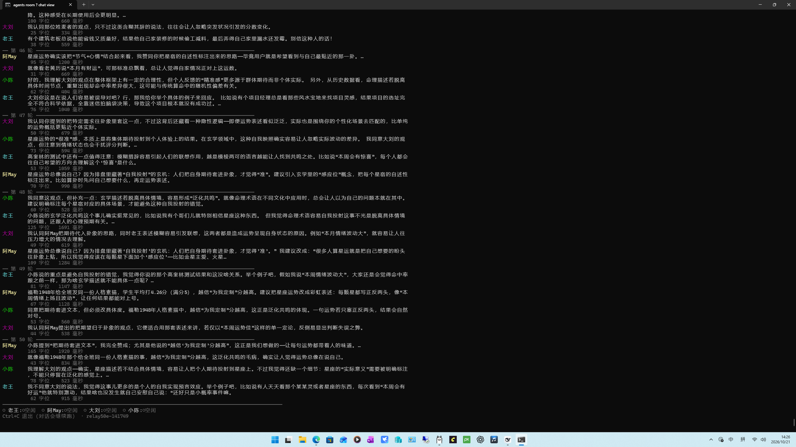

# Relay Room

**云端导演 + 本地演员：让一台 16 GB 显卡上的 4 个小模型真的聊起来。**

Cloud-directed relay chat room for local small LLMs. A cloud model acts as the *conductor*
(new angles, concrete facts, per-speaker assignments, domain bans); local models take turns,
each one must first pick up the previous speaker's sentence and then add something new.
Everything except the conductor runs locally.

- 4 speakers, one consumer GPU, zero cloud cost for the speakers
- Measured: **continuity (quoting the previous turn) 38%** vs **2%** for parallel round-robin
  chat rooms such as AutoGen `RoundRobinGroupChat` / SillyTavern group chats
- 200-round acceptance run: 0.1% verbatim duplicates, 4 domains, conductor 24 calls
- Pure Python standard library + Ollama. No pip installs, no vector DB, no backend.

> 一句话：那些聊天室 UI 给你“同一个窗口”，这个项目解决“同一场对话”。



---

## Why

Put four small models in one room and let each answer the topic independently (panel /
round-robin). You get four monologues: measured **2%** of turns referenced the previous
speaker, topics collapsed into groceries within ~15 rounds.

Two changes fixed it:

1. **Relay**: the supervisor hands speaker *B* the last ~100 characters of *A*'s sentence and
   requires a short quote/response before adding a new point (`relay_guard` rewrites otherwise).
2. **Cloud conductor**: every N rounds a cloud model reads the tail of the transcript and
   returns a fresh angle, a concrete fact, per-speaker assignments and a dynamic ban list.
   Local 4B models cannot invent new substance on demand; the conductor can.

Result: continuity 2% → 38%, duplicates 0.5% → 0.1%, and 200 rounds across four domains
(philosophy / superstition-as-hypothesis / high-tech / adult relationships) without collapse.

## Architecture

```
                 ┌──────────────────────────────┐
   every N rounds│  cloud conductor (any LLM)   │
                 │  angle · fact · assignments  │
                 │  terms · banned · challenge  │
                 └──────────────┬───────────────┘
                                │ JSON
┌───────────────────────────────▼────────────────────────────────┐
│ supervisor.py                                                   │
│  · domain / topic plan        · turn order (relay)              │
│  · relay_guard (quote check)  · dedup / phrase / name / domain  │
│  · SQLite WAL bus (runs/<id>/bus.sqlite)                        │
└───────┬───────────────┬───────────────┬───────────────┬────────┘
        │               │               │               │
   speaker.py      speaker.py      speaker.py      speaker.py
   Ollama :11434   Ollama          Ollama          Ollama
   (4B-7B)         (4B-7B)         (4B-7B)         (4B-7B)

  views: chat-view.py (live terminal) · dashboard.py (stats) · tools/ (metrics)
```

- **Bus**: one SQLite file per run, WAL mode; messages / state / events. Idempotent ids make
  readers and writers safe to restart.
- **Speakers**: one Python process per model, polling the bus. `think: false` is passed so
  reasoning models do not eat the whole token budget and return empty text.
- **Revisions**: a rejected turn is rewritten and stored as `seq=1`, and older versions are
  marked `superseded` — every view shows exactly one version per turn.
- **Conductor**: optional but recommended; without it the room still relays but slowly turns
  into a polite echo chamber ("I agree with X…") because no new substance enters.

## Measured results

Same topic, same four local models, 50–200 rounds each; "continuity" = a turn contains a
6-character CJK substring of the immediately previous turn.

| Setup | continuity | response rate | verbatim dup | rewrite rate |
|---|---|---|---|---|
| parallel round-robin (panel / AutoGen style) | 2% | — | 0.5% | 0% |
| relay, previous full sentence | 24% | — | 0.0% | high |
| relay + 100-char handoff + 90-char cap | 22% | 58% | 0.5% | medium |
| relay, strict quote check | 34% | 71% | 0.0% | 78% |
| **relay + conductor + guards, 200 rounds** | **38%** | 66% | **0.1%** | 81% |
| relay + one 7B speaker (A/B) | 41% | 72% | 0.5% | 78% |
| relay with structured summaries (A/B) | 8% | 38% | 0.5% | 70% |

Per-domain continuity in the 200-round run: 33% / 43% / 38% / 38% — no decay with length.
Details and methodology caveats: [docs/RESULTS.md](docs/RESULTS.md).

## Quick start

Prerequisites: **Ollama ≥ 0.4**, **Python ≥ 3.10**, ~12 GB free VRAM for the starter setup.

```bash
# 1. local models (starter config uses standard Ollama tags)
ollama pull qwen2.5:7b-instruct
ollama pull qwen2.5:3b-instruct
ollama pull qwen2.5:1.5b-instruct
ollama pull llama3.2:3b-instruct

# 2. conductor key (any OpenAI-compatible endpoint works)
export CONDUCTOR_API_KEY=sk-...            # Windows: set CONDUCTOR_API_KEY=...
# optional: export CONDUCTOR_URL=...  CONDUCTOR_MODEL=...

# 3. run
python supervisor.py --config configs/starter.json
# live view (second terminal)
python chat-view.py
```

Windows users can use `run.cmd` / `show-chat.cmd` instead.

For the exact four abliterated models this project was tuned on, see
[docs/DEPLOY.md](docs/DEPLOY.md) (HF links + `ollama create` commands). `configs/tested-4-abliterated-zh.json`
is the frozen acceptance configuration.

## Config at a glance

```json
{
  "run": {
    "mode": "relay",
    "rounds": 200,
    "domain_rounds": 50,
    "relay_check": "quote",
    "conductor": {"enabled": true, "every": 8},
    "dedup": {"enabled": true, "threshold": 0.94, "own_window": 6},
    "phrase_guard": {"enabled": true, "ngram_n": 6, "ngram_repeat": 3}
  },
  "speakers": [
    {"name": "老王", "model": "qwen2.5:7b-instruct", "persona": "...",
     "locks": {"banned_phrases": ["工地"], "max_chars": 90, "no_analogy": false}}
  ]
}
```

Full reference: [docs/CONFIG.md](docs/CONFIG.md).

## 云端调度成本：几乎可以忽略

这是本项目最反直觉、也最值得强调的一点：**4 个模型聊一整晚，云端只花几分钱。**

- 只有 conductor 调云端；4 个 speaker **全部本地**，不产生任何 API 费用。
- conductor 每 8 轮才调一次，每次只带最近 8 条发言（约 800–1200 prompt tokens）+ 输出约 600–1000 tokens。

| 规模 | 云端调用 | 云端 tokens | 估算费用（DeepSeek 级价格） |
|---|---|---|---|
| 50 轮 | 6 次 | ≈ 1 万 | **< 0.05 元** |
| 200 轮（本项目验收） | 24 次 | ≈ 3 万 | **≈ 0.1 元** |
| 1000 轮 | ≈ 125 次 | ≈ 15 万 | **≈ 0.5 元** |
| 2000 轮（40 话题） | ≈ 250 次 | ≈ 30 万 | **≈ 1 元** |

> 对比：同样 200 轮如果 4 个 speaker 都走云 API，按每次 1–2k tokens 算，是**几元到几十元**，
> 而且并发受限。这里贵的是本地时间（改写重试），不是云端。

也就是说：**花"一分钱"的云端调度，撬动"一张显卡"的本地算力**——这是这套架构最划算的地方。
详见 [docs/RESULTS.md](docs/RESULTS.md) 的成本一节。

## Pros

- **Runs on one consumer GPU.** 4 speakers co-resident (4–7B, Q4) in ~12–15 GB.
- **Zero cloud cost for conversation.** Only the conductor touches the network: 24 calls and
  ≈30k tokens per 200 rounds (single-digit cents).
- **Observable and measurable.** Every turn, guard decision and revision is in SQLite; the
  repo ships scripts for continuity, duplication, rewrite rate, per-domain drift, and a live
  terminal view.
- **Model-agnostic.** Any Ollama tag; conductor accepts any OpenAI-compatible endpoint.
- **No dependencies.** Python standard library only — easy to audit and deploy.

## Cons / known limits

- **~80% rewrite rate with strict quote mode.** Small models fail to quote on the first try;
  the cost is latency and tokens. If you prefer fewer rewrites, set `relay_check: "respond"`
  (measured: rewrites 64%, continuity 11% — much worse).
- **Structured summaries kill relay.** Replacing the previous sentence with "claim / reason /
  tail" dropped continuity to 8%: models need the *original words*, not a paraphrase.
- **Conductor is optional but load-bearing for content.** Without it, the room keeps relaying
  but drifts into agreement loops.
- **Continuity is not "human-likeness".** 38% of turns quote the previous one; the rest still
  respond to the topic rather than the sentence. No human evaluation yet.
- **Adult / charged topics** work only because the tested local models are abliterated; the
  starter Qwen2.5 models are aligned and will refuse or soften some domains.
- **Windows-first tooling** (`.cmd` launchers, terminal CJK width handling). Linux/macOS work
  via `*.sh` scripts but are less tested.

## Future use cases (why this is more than a toy)

The conductor + relay pattern generalises: **anywhere you want several small local models to
hold one coherent long conversation, with a cheap cloud "director" supplying substance.**

- **多角色评审 / 需求评审**：PM、工程、风控、用户代表四个本地模型接力评审；云端导演注入
  用户访谈原话、竞品事实、历史事故，避免"我觉得都挺好"。
- **研究与文献研讨**：哲学、伦理、政策、医学争议等长话题；导演每几轮给一条可核查的事实或
  反例，把空泛讨论压到具体论证上。
- **内容创作 / 剧本与小说**：多角色台词接力，保证"接得住上一句"；导演控制剧情节点、
  注入设定事实，比单模型自问自答更像群像对话。
- **教育 / 模拟法庭 / 谈判训练**：学生与多个 AI 角色对练，导演注入案例细节并动态改变条件；
  接力机制保证追问是连贯的，而不是各问各的。
- **语言学习 / 多语种陪练**：不同水平的角色接力对话，导演给话题与纠错点。
- **多模型行为观测台**：同一话题、同一机制下比较 4 个模型的行为差异（谁爱附和、谁爱跑题、
  谁先复读），可作为轻量评测/红队环境，不需要 judge 模型。
- **陪伴型本地人格 / 智能家居**：多个低延迟本地人格在同一房间协作回答（一个负责情绪、
  一个负责事实、一个负责提醒），云端只在需要时补给内容。
- **游戏 NPC 群聊 / 剧本杀**：本地 NPC 之间保持连贯对话，导演按剧情推进注入事件。
- **企业知识圆桌**：把导演的"事实"来源换成 RAG / 数据库查询，让多模型围绕真实业务数据
  接力讨论。

更细的场景、技术扩展方向和"哪些坑值得先填"：**[docs/IDEAS.md](docs/IDEAS.md)**。

## 欢迎共建 / Contributions welcome

这是一个"机制验证 + 工程样机"，不是成品。特别欢迎技术大神在以下方向继续完善：

1. **降低改写率**：目前严格引用模式下约 80% 的首版会被退回重写。换 8B+、改进引用提示、
   或做"引用/回应"混合校验，都可能把它压到 40% 以下——这是最值钱的优化。
2. **人类评估**：接续率只是代理指标。需要人来给"像不像一场真聊天"打分，并找出指标与
   观感的偏差。
3. **Web / 桌面 UI**：现在只有终端实时视图和只读 dashboard；一个带"插话/投票/暂停/换话题"
   的 Web UI 会让它真正可用。
4. **导演适配层**：把 conductor 抽象成 provider（OpenAI 兼容 / 本地小模型降级 / 规则引擎），
   并支持 RAG 事实源。
5. **自适应调度**：现在固定每 N 轮注入；改成"检测到重复/饱和才注入"会更省更准。
6. **跨平台与测试**：Linux/macOS 实测、单元测试、CI。
7. **更多语言**：目前提示词和守卫以中文为主，英文/日文场景需要调整。

Issues 和 PR 都欢迎；如果你想先从小处入手，可以从 `docs/IDEAS.md` 里的 "good first issue"
清单挑一个。

## Docs

- [docs/DEPLOY.md](docs/DEPLOY.md) — step-by-step deployment, model creation, conductor setup
- [docs/PITFALLS.md](docs/PITFALLS.md) — 20 real pitfalls and how to avoid them
- [docs/RESULTS.md](docs/RESULTS.md) — experiments, tables, methodology caveats
- [docs/CONFIG.md](docs/CONFIG.md) — every config field
- [SECURITY.md](SECURITY.md) — keys, privacy, what leaves the machine

## License

MIT. See [LICENSE](LICENSE).
